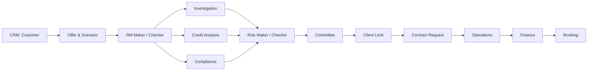

# Oracle APEX Learning Journey

A hands-on record of learning **Oracle APEX** from scratch. The learning was done by installing a full local Oracle stack and walking a real leasing-finance application (EGYLEASE / *FinCore*) end to end, guided by Claude.

---

## Table of Contents
- [Overview](#overview)
- [Repository Contents](#repository-contents)
- [Tech Stack](#tech-stack)
- [Local Environment](#local-environment)
- [Learning Roadmap](#learning-roadmap)
- [Certification Path](#certification-path)
- [Case Study: Leasing Lifecycle](#case-study-leasing-lifecycle)
- [Progress](#progress)
- [Key Takeaways](#key-takeaways)
- [Resources](#resources)
- [Disclaimer](#disclaimer)

---

## Overview
This repository documents a practical path from an **APEX beginner** (with an existing SQL, PL/SQL and C# background) to building and understanding production-grade APEX applications. It covers:

- Installing **Oracle AI Database 26ai Free**, **APEX 26.1** and **ORDS 26.2** on Windows
- Restoring an existing enterprise schema and a 538-page APEX application from a Data Pump dump
- Tracing business logic across pages, PL/SQL packages and **Flows for APEX** BPMN workflows
- Walking a complete customer lifecycle, from CRM onboarding to contract and installment schedule
- Spotting and documenting real-world bugs

## Repository Contents
| File | Description |
|---|---|
| [`CHAT.md`](CHAT.md) | Full learning conversation in chronological order, mostly in Egyptian Arabic. It is sanitized: credentials, e-mail addresses and session IDs are redacted, and raw tool output is omitted |
| `README.md` | This document |

## Tech Stack
| Layer | Technology |
|---|---|
| Database | Oracle AI Database 26ai Free (23.26), CDB `FREE` / PDB `FREEPDB1` |
| Low-code platform | Oracle APEX 26.1 |
| REST / web listener | Oracle REST Data Services (ORDS) 26.2, standalone mode on port 8080 |
| Workflow engine | Flows for APEX (BPMN 2.0) |
| Languages | SQL, PL/SQL, JavaScript |
| Tools | SQL*Plus, PL/SQL Developer, Data Pump (`impdp`) |

## Local Environment
1. **Database:** install Oracle AI Database 26ai Free. Use the service name `freepdb1.localdomain`.
2. **APEX:** run `apexins.sql` inside the PDB, then load the Arabic language pack.
3. **ORDS:** install in proxied mode, set the static images path, and start it with `ords serve`. The app is then at `http://localhost:8080/ords/`.
4. **Workspace:** create a workspace mapped to the application schema.
5. **Restore:** import the schema with `impdp`, apply missing grants and objects, recompile, then import the application export.

> Lessons learned: Oracle XE and 26ai Free cannot coexist, XE does not support JDBC proxy sessions (ORA-00439), and `NONEDITIONABLE` objects need to be recreated explicitly (ORA-38824).

---

## Learning Roadmap
Estimated duration: **8 to 12 weeks** at 1 to 2 hours per day.

### Phase 0: SQL & PL/SQL Foundations *(1 to 2 weeks, skip if already fluent)*
- [x] `SELECT`, joins, aggregation, DML
- [x] Tables, primary keys and foreign keys
- [x] PL/SQL blocks, procedures, functions, cursors, exceptions

### Phase 1: Getting Started with APEX *(1 week)*
- [x] Workspaces, schemas, applications and pages
- [x] SQL Workshop: Object Browser, SQL Commands, **Quick SQL**
- [ ] Create apps from a table and from a spreadsheet
- [ ] Explore the Sample Gallery apps

### Phase 2: Pages & Components *(2 weeks)* ⭐
- [ ] Page Designer
- [ ] Interactive Report, Interactive Grid, Form, Cards, Charts, Faceted Search, Calendar
- [ ] Items and LOVs, buttons, branches
- **Exercise:** an employee directory with report, form and chart

### Phase 3: Logic & Interactivity *(2 weeks)*
- [ ] Session state and bind variables (`:P1_ITEM`)
- [ ] Validations, processes, computations
- [ ] **Dynamic Actions**
- [ ] Shared Components: LOVs, lists, navigation
- **Exercise:** a leave-request app with date validation and day calculation

### Phase 4: Security *(1 week)*
- [ ] Authentication schemes, including custom authentication
- [ ] Authorization schemes and role-based access
- **Exercise:** manager-only approval

### Phase 5: UI & Professional Finish *(1 week)*
- [ ] Universal Theme, Theme Roller, template options
- [ ] Arabic / RTL applications
- [ ] JavaScript and CSS inside APEX

### Phase 6: Advanced *(ongoing)*
- [ ] REST Data Sources and ORDS RESTful services
- [ ] APIs: `APEX_MAIL`, `APEX_DATA_EXPORT`, `APEX_COLLECTION`, `APEX_SESSION`
- [ ] Workflows and approvals, including Flows for APEX (BPMN)
- [ ] Automations and background jobs
- [ ] Plugins
- [ ] Deployment: export/import and CI for APEX apps

### Phase 7: Capstone Project
Build a complete **FinCore**-style finance application:
- [ ] Accounts and transactions
- [ ] Dashboard with KPIs
- [ ] PDF and Excel reports
- [ ] Role-based access (accountant, manager)
- [ ] Arabic UI

---

## Certification Path
| Step | Course / Exam | Provider | Cost |
|---|---|---|---|
| 1 | Oracle APEX: Foundations | Oracle | Free |
| 2 | Become an Oracle APEX Developer Professional (MyLearn) | Oracle University | Free |
| 3 | Practice exams | Udemy or similar | Low cost |
| 4 | **Oracle APEX Cloud Developer Professional: `1Z0-771`** | Oracle University | Paid; check the current price on Oracle's site |

**Suggested schedule**
| Weeks | Focus |
|---|---|
| 1 to 2 | Foundations course and hands-on practice |
| 3 to 8 | Developer Professional path, this roadmap and the capstone |
| 9 | Practice exams |
| 10 | 🏆 `1Z0-771` exam |

> Avoid exam "dumps". They violate Oracle's certification policy and can lead to revocation.

---

## Case Study: Leasing Lifecycle
The core learning exercise was walking one customer through the full **lease-finance lifecycle** and reading the logic behind every step.

| Stage | What happens under the hood |
|---|---|
| Application | A BPMN process instance is started; every step is a Maker/Checker task mapped to a role |
| Parallel review | A parallel gateway splits into Investigation, Credit Analysis and Compliance, then joins before Risk |
| Risk | The approving committee is selected by amount band |
| Committee "Post" | The client credit limit is created (valid for 11 months) |
| Contract | Validated against the client limit and the parent group limit |
| Calculate | An installment schedule is generated (advance or arrear, PMT-based, actual/365 day count) |

The application also contains workflows for Lease Contract Requests, Factoring applications and Supplier/Buyer onboarding.

## Progress
- [x] Local Oracle 26ai + APEX 26.1 + ORDS 26.2 environment
- [x] Schema and 538-page application restored
- [x] Application workflow: RM → Investigation / Credit / Compliance → Risk → Committee
- [x] Client limit created
- [x] Contract request created and installment schedule calculated
- [ ] Contract workflow: Operations → Finance → Booking
- [ ] Certification `1Z0-771`

## Key Takeaways
- **Read the metadata.** The `APEX_APPLICATION_*` dictionary views explain an app faster than clicking through 500 pages.
- **Conditions hide buttons.** A button that is never shown usually has a `Never` condition or a role check; inspect it before assuming a bug.
- **Workflows live outside pages.** In BPMN-driven apps, the real state is in the process engine tables, not in the page.
- **Validate data at the source.** Several downstream issues came from empty or mis-mapped values entered at earlier stages.
- **Back up before changing data,** and keep every change reproducible as a script.

## Resources
- [Oracle APEX](https://apex.oracle.com)
- [Oracle APEX Documentation](https://docs.oracle.com/en/database/oracle/apex/)
- [Oracle LiveLabs](https://livelabs.oracle.com)
- [Oracle MyLearn](https://mylearn.oracle.com)
- [Flows for APEX](https://flowsforapex.org)

## Disclaimer
This repository is for **personal learning** only. The application studied belongs to its respective owner. No source code, data dumps or credentials from it are published here, and the conversation log has been sanitized.
